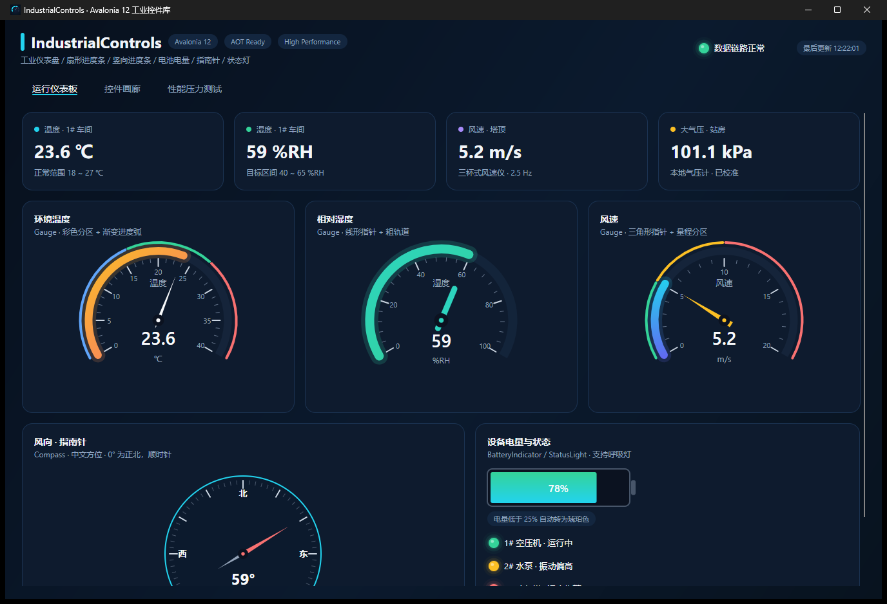
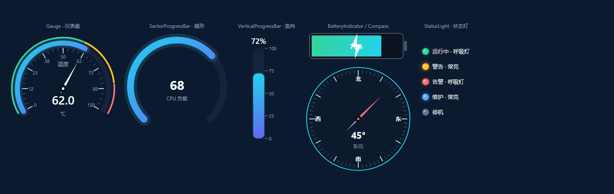
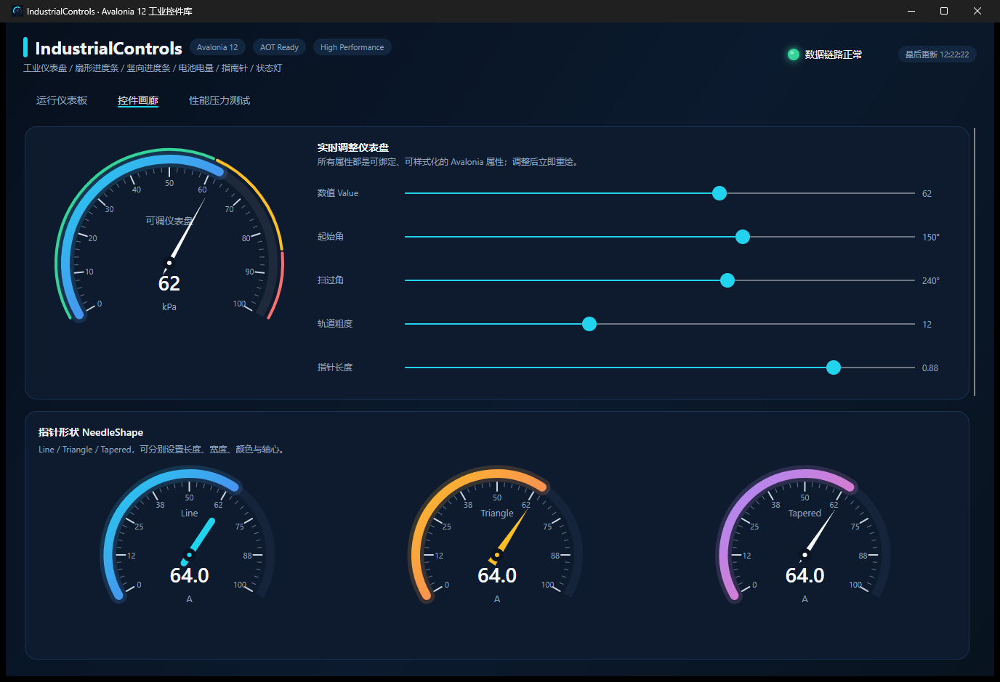
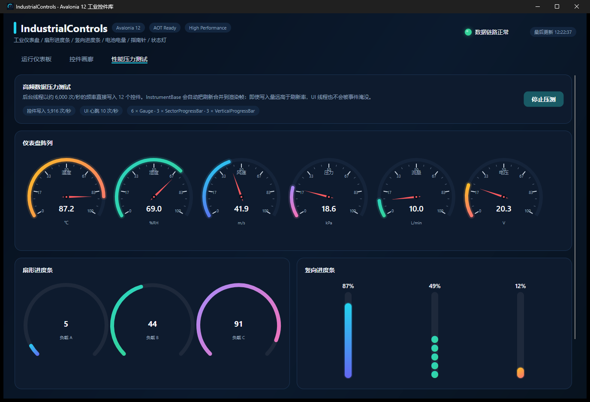

# IndustrialControls · Industrial Controls for Avalonia 12

[English](README.en.md) | [简体中文](README.md)

A set of industrial controls for **Avalonia 12 / .NET 8+**: gauge, sector progress bar, vertical progress bar, battery indicator, compass and status light.
Dark industrial styling, highly customizable properties, AOT friendly, with render batching and caching optimized for **high-frequency data updates**.

[](https://www.nuget.org/packages/IndustrialControls.Avalonia)
[](https://avaloniaui.net/)
[](https://dotnet.microsoft.com/)
[](LICENSE)



---

## 1. Features

| Capability | Description |
|---|---|
| `Gauge` | Custom sector range, tick density, colored ranges, needle shape/length/width/color, title/unit/value text position, size, color and font |
| `SectorProgressBar` | Any sweep from 270° to 360°, gradient brushes, rounded caps, glow, centered value and label text |
| `VerticalProgressBar` | Continuous or segmented fill, bottom-up/top-down direction, rounded corners, right-side scale, value on top — ideal for level, tank and humidity |
| `BatteryIndicator` | Level fill, automatic low/critical colors, charging bolt, percentage text |
| `Compass` | Heading angle, English/Chinese cardinals, heading and direction text, major/minor ticks — also usable as a wind vane |
| `StatusLight` | Normal/Warning/Alarm/Maintenance/Off, optional pulsing and label text |
| High-frequency updates | `Value` can be assigned from any thread; the control marshals to the UI thread and merges updates per frame; static parts are cached |
| AOT / trimming | `IsAotCompatible`, no reflection, dynamic types or runtime serialization; compiled XAML bindings |
| Cross-platform | Windows / Linux / macOS (all desktop platforms supported by Avalonia 12) |

> This project is an independent implementation. Only the interaction and visual concept of "industrial gauges" were inspired
> community projects such. No third-party source code, images or assets were copied; all drawing code, API design
> and colors are original.

---

## 2. Requirements

- Avalonia **12.1.1** or later (the NuGet dependency floor is pinned to 12.1.1, so any Avalonia 12 version from 12.1.1 up works as-is)
- .NET **8.0** or later (the library targets `net8.0` and can be consumed by net8 / net9 / net10 hosts)
- Desktop platforms: Windows / Linux / macOS

> **Version compatibility**: the package depends on **Avalonia 12.1.1**, the lowest usable version in that line. NuGet treats a
> plain `PackageReference` version as a *minimum*, so hosts pinned to 12.1.1, 12.1.6, 12.2.x or any other Avalonia 12 release
> need no extra configuration; NuGet only resolves the 12.1.1 dependency when the host is older than that.

---

## 3. Installation

### 3.1 NuGet

```bash
dotnet add package IndustrialControls.Avalonia --version 1.0.1
```

### 3.2 Project reference

```xml
<ItemGroup>
  <ProjectReference Include="..\IndustrialControls\src\IndustrialControls\IndustrialControls.csproj" />
</ItemGroup>
```

### 3.3 Namespace

```xml
xmlns:ic="https://github.com/daipeng0809/IndustrialControls"
```

---

## 4. Quick Start

```xml
<UserControl xmlns="https://github.com/avaloniaui"
             xmlns:x="http://schemas.microsoft.com/winfx/2006/xaml"
             xmlns:ic="https://github.com/daipeng0809/IndustrialControls">

  <ic:Gauge Width="300" Height="300"
            Minimum="0" Maximum="100" Value="42"
            Title="Temperature" Unit="℃" ValueFormat="F1"
            ProgressBrush="#22D3EE"
            TrackBrush="#15243A">

    <!-- Colored ranges: normal / warning / danger -->
    <ic:Gauge.Ranges>
      <ic:GaugeRange From="0"  To="60" Brush="#34D399" />
      <ic:GaugeRange From="60" To="85" Brush="#FBBF24" />
      <ic:GaugeRange From="85" To="100" Brush="#F87171" />
    </ic:Gauge.Ranges>
  </ic:Gauge>
</UserControl>
```

```csharp
// Safe from a background acquisition thread; the control marshals and batches per frame
gauge.Value = ReadSensorValue();
```

Run the demo:

```bash
dotnet run --project samples/IndustrialControls.Demo
```

---

## 5. Data Refresh and Performance Design

### 5.1 Writing `Value` from any thread

`Value` is a **DirectProperty**. Its setter does two things:

1. **Thread marshaling**: if the caller is not on the control's dispatcher, only the latest pending value is recorded; no UI state is touched directly;
2. **Frame batching**: at most one marshaled operation is pending at a time, and the next frame applies only the latest value and invalidates once.

The following is therefore safe even at tens of thousands of writes per second:

```csharp
_ = Task.Run(async () =>
{
    while (true)
    {
        gauge.Value = ReadSensorValue();   // write directly from the acquisition thread
        await Task.Delay(10);
    }
});
```

> `Value` uses a DirectProperty to perform marshaling and batching inside the setter. It **supports binding**
> (OneWay / TwoWay) but **does not support Style setters**. All other appearance properties are regular StyledProperties
> and can be styled and animated.

### 5.2 Why the UI stays responsive

| Optimization | Location | Effect |
|---|---|---|
| Refresh request batching | `InstrumentBase.RequestRender` / `Value` setter | High-frequency background writes create very few UI-thread jobs |
| Static cache | `RebuildStatic` in each control | Ticks, labels, ranges and title are rebuilt only when size/appearance changes |
| Geometry reuse | `MutableArc` / cached needle geometry | Progress arcs and needles only update parameters per frame; no new geometry objects |
| Text cache | Reused `FormattedText` fields | Value text is re-laid out only when the formatted result changes |
| Draw-only controls | `Render(DrawingContext)` override | No children, no template; value changes do not trigger measure/layout |
| Immutable default brushes | `IndustrialPalette` | Default brushes are shared across controls, avoiding per-frame allocations |

The stress-test page of the sample measures **~6,000 control writes per second** with a stable
**UI heartbeat of 10/10 per second**, no stutter and no cross-thread exceptions.

### 5.3 Threading contract

- `Value`: writable from **any thread**.
- `Minimum` / `Maximum` / `Ranges` / fonts, colors and angles: modify on the **UI thread** (one-time configuration).
- The `StatusLight` pulse animation uses a `DispatcherTimer` that runs only while `IsPulsing = true` and the control is attached to the visual tree.

---

## 6. Angle Convention

All angles are in **degrees**; `0°` points to **3 o'clock** and **clockwise is positive**:

- `Gauge` defaults to `StartAngle = 150`, `SweepAngle = 240`: starts at the lower left and sweeps clockwise to the lower right.
- `SectorProgressBar` defaults to `StartAngle = 135`, `SweepAngle = 270`.
- `Compass` interprets `Value` as a heading: `0` is north, clockwise (east = 90, south = 180, west = 270).

---

## 7. Control Reference



### 7.1 `Gauge`

#### Value and text

| Property | Default | Description |
|---|---|---|
| `Value` / `Minimum` / `Maximum` | `0 / 0 / 100` | Current value and range |
| `ValueFormat` | `"F1"` | Value format (`"F0"`, `"0.0"`, ...) |
| `ShowValueText` | `true` | Show the value text |
| `ValueFontSize` / `ValueBrush` / `ValueFontFamily` / `ValueFontWeight` | `28` / near-white / system / `SemiBold` | Value text style |
| `ValueOffset` | `(0, 26)` | Value text offset in pixels from the dial center |
| `Title` / `TitleFontSize` / `TitleBrush` / `TitleFontFamily` / `TitleOffset` | empty / `13` / gray / system / `(0, -58)` | Title text |
| `Unit` / `UnitFontSize` / `UnitBrush` / `UnitFontFamily` / `UnitOffset` | empty / `13` / gray / system / `(0, 60)` | Unit text |

`TitleOffset`, `UnitOffset` and `ValueOffset` are `Point` values written as `"0,60"`; text is always drawn centered on that point.

#### Dial and ticks

| Property | Default | Description |
|---|---|---|
| `StartAngle` / `SweepAngle` | `150 / 240` | Sector range |
| `TrackThickness` / `TrackBrush` | `12` / `#1E293B` | Track thickness and color |
| `ShowProgress` / `ProgressBrush` / `ProgressGlow` | `true` / `#22D3EE` / `true` | Progress arc (gradients supported) and glow |
| `ShowTickMarks` | `true` | Show tick marks |
| `MajorTickCount` | `11` | Number of major ticks (including both ends) |
| `MinorTicksPerMajor` | `4` | Minor ticks between two major ticks |
| `MajorTickLength` / `MinorTickLength` | `12 / 6` | Tick length |
| `MajorTickWidth` / `MinorTickWidth` | `2 / 1` | Tick width |
| `MajorTickBrush` / `MinorTickBrush` | `#CBD5E1` / `#64748B` | Tick colors |
| `ShowScaleLabels` / `ScaleLabelFormat` | `true` / `"F0"` | Scale labels and format |
| `ScaleLabelFontSize` / `ScaleLabelBrush` / `ScaleLabelFontFamily` / `ScaleLabelOffset` | `11` / `#94A3B8` / system / `8` | Scale label style and radial spacing |

#### Needle

| Property | Default | Description |
|---|---|---|
| `ShowNeedle` | `true` | Show the needle |
| `NeedleShape` | `Tapered` | `Line` / `Triangle` / `Tapered` |
| `NeedleLength` | `0.88` | Length ratio (0~1) relative to the inner tick circle |
| `NeedleWidth` | `6` | Needle width |
| `NeedleBackLength` | `0.16` | Tail length ratio used by Triangle / Tapered |
| `NeedleBrush` | `#FF5A5F` | Needle color |
| `NeedleHubRadius` / `NeedleHubBrush` | `9` / `#0B1220` | Hub radius and color |

#### Colored ranges

| Property | Default | Description |
|---|---|---|
| `Ranges` | empty | `GaugeRange` collection, colored by value range |
| `RangeThickness` / `RangeGap` | `4 / 2` | Outer band thickness and angular gap |

`GaugeRange`: `From`, `To`, `Brush`, `Thickness` (`NaN` = use `Gauge.RangeThickness`).
The gauge refreshes automatically after the collection or any range property changes.

#### Customization example

```xml
<!-- Wind speed: triangle needle, value ranges, light scale labels -->
<ic:Gauge Width="300" Height="300"
          Minimum="0" Maximum="20" Value="8.6"
          StartAngle="200" SweepAngle="220"
          TrackThickness="10"
          Title="Wind speed" Unit="m/s" ValueFormat="F1"
          TitleFontSize="12" UnitFontSize="12"
          ValueFontSize="30" ValueOffset="0,34"
          TitleOffset="0,-72" UnitOffset="0,68"
          ScaleLabelFontSize="10" ScaleLabelOffset="6"
          MajorTickCount="5" MinorTicksPerMajor="4"
          NeedleShape="Triangle" NeedleWidth="10" NeedleLength="0.9"
          NeedleBrush="#FBBF24"
          ProgressBrush="#22D3EE">
  <ic:Gauge.Ranges>
    <ic:GaugeRange From="0" To="5" Brush="#34D399" />
    <ic:GaugeRange From="5" To="10" Brush="#FBBF24" />
    <ic:GaugeRange From="10" To="20" Brush="#F87171" />
  </ic:Gauge.Ranges>
</ic:Gauge>
```

### 7.2 `SectorProgressBar`

| Property | Default | Description |
|---|---|---|
| `Value` / `Minimum` / `Maximum` | `0 / 0 / 100` | Value and range |
| `StartAngle` / `SweepAngle` | `135 / 270` | Sector range; `SweepAngle = 360` renders a full circle |
| `Thickness` | `14` | Arc thickness |
| `TrackBrush` / `ProgressBrush` | `#1E293B` / `#22D3EE` | Track/progress colors (gradients supported) |
| `ProgressGlow` | `true` | Progress glow |
| `RoundCaps` | `true` | Rounded arc caps |
| `ShowValueText` / `ValueFormat` | `true` / `"F0"` | Centered value |
| `ValueFontSize` / `ValueBrush` / `ValueFontFamily` / `ValueFontWeight` / `ValueOffset` | `30` / white / system / `Bold` / `(0,-4)` | Value text style |
| `Label` / `LabelFontSize` / `LabelBrush` / `LabelFontFamily` / `LabelOffset` | empty / `12` / gray / system / `(0,28)` | Label text |

```xml
<ic:SectorProgressBar Height="240" Value="68" Label="CPU load"
                      StartAngle="135" SweepAngle="270" Thickness="16"
                      TrackBrush="#15243A">
  <ic:SectorProgressBar.ProgressBrush>
    <LinearGradientBrush StartPoint="0%,0%" EndPoint="100%,100%">
      <GradientStop Color="#22D3EE" Offset="0" />
      <GradientStop Color="#6366F1" Offset="1" />
    </LinearGradientBrush>
  </ic:SectorProgressBar.ProgressBrush>
</ic:SectorProgressBar>

<!-- Full-circle ring -->
<ic:SectorProgressBar Height="200" Value="42" StartAngle="-90" SweepAngle="360"
                      Thickness="16" ProgressBrush="#A78BFA" />
```

### 7.3 `VerticalProgressBar`

| Property | Default | Description |
|---|---|---|
| `Direction` | `BottomToTop` | Fill direction, or `TopToBottom` |
| `BarWidth` / `CornerRadius` | `22 / 8` | Bar width and corner radius |
| `TrackBrush` / `ProgressBrush` / `ProgressGlow` | `#1E293B` / `#22D3EE` / `true` | Track and fill |
| `SegmentCount` / `SegmentGap` | `0 / 4` | Segment count (0 = continuous) and gap |
| `ShowValueText` / `ValueFormat` / `Unit` | `true` / `"F0"` / empty | Value on top |
| `ValueFontSize` / `ValueBrush` / `ValueFontFamily` / `ValueFontWeight` | `18` / white / system / `SemiBold` | Value text style |
| `ShowScale` / `ScaleCount` | `false / 5` | Right-side scale |
| `TickLength` / `TickWidth` / `TickBrush` | `6 / 1.5` / `#64748B` | Tick lines |
| `ScaleLabelFormat` / `ScaleLabelFontSize` / `ScaleLabelBrush` / `ScaleLabelFontFamily` | `"F0"` / `11` / gray / system | Scale labels |

```xml
<!-- Level: continuous + scale -->
<ic:VerticalProgressBar Width="90" Height="260" Value="72" Unit="%"
                        ShowScale="True" ScaleCount="5"
                        BarWidth="28" CornerRadius="10"
                        ProgressBrush="#22D3EE" />

<!-- Segmented level/battery -->
<ic:VerticalProgressBar Width="80" Height="260" Value="55" Unit="%"
                        SegmentCount="12" SegmentGap="4"
                        BarWidth="26" ProgressBrush="#34D399" />
```

### 7.4 `BatteryIndicator`

| Property | Default | Description |
|---|---|---|
| `Value` | `0` | Battery level (with `Minimum`/`Maximum`, default 0~100) |
| `BodyBrush` / `BorderBrush` / `BorderThickness` / `CornerRadius` | `#0B1220` / `#475569` / `2` / `8` | Shell |
| `TerminalBrush` / `TerminalWidth` / `TerminalHeightRatio` | `#475569` / `7` / `0.4` | Positive terminal |
| `FillPadding` | `3` | Fill inner padding |
| `FillBrush` / `LowBrush` / `CriticalBrush` | green / amber / red | Three-level colors |
| `UseLevelColors` / `LowThreshold` / `CriticalThreshold` | `true` / `0.3` / `0.15` | Automatic level coloring |
| `IsCharging` / `ShowChargingBolt` / `ChargingBoltBrush` | `false` / `true` / white | Charging state and bolt |
| `ShowValueText` / `ValueFormat` / `Unit` | `true` / `"F0"` / `"%"` | Value text |
| `ValueFontSize` / `ValueBrush` / `ValueFontFamily` / `ValueFontWeight` | `16` / white / system / `SemiBold` | Text style |

```xml
<ic:BatteryIndicator Width="220" Height="56" Value="82" IsCharging="True" />
<ic:BatteryIndicator Width="220" Height="56" Value="8" />   <!-- turns red automatically -->
```

### 7.5 `Compass`

| Property | Default | Description |
|---|---|---|
| `Value` | `0` | Heading 0~360 (0 = north, clockwise) |
| `ShowCardinalLabels` / `UseChineseCardinalLabels` | `true / false` | Show N/E/S/W or 北/东/南/西 |
| `CardinalLabelFontSize` / `CardinalLabelBrush` / `CardinalLabelFontFamily` | `13` / white / system | Cardinal label style |
| `TickCount` / `MajorTickEvery` | `72 / 6` | Tick count and major tick interval |
| `MajorTickLength` / `MinorTickLength` / `MajorTickWidth` / `MinorTickWidth` | `12 / 6 / 2 / 1` | Tick sizes |
| `MajorTickBrush` / `MinorTickBrush` | `#CBD5E1` / `#64748B` | Tick colors |
| `DialBrush` / `BezelBrush` / `BezelThickness` | `#1E293B` / `#475569` / `2` | Dial and bezel |
| `ShowNeedle` / `NeedleBrush` / `SouthNeedleBrush` | `true` / red / gray | Needle |
| `NeedleLength` / `NeedleWidth` / `NeedleHubRadius` / `NeedleHubBrush` | `0.62 / 6 / 8 / #0B1220` | Needle size and hub |
| `ShowHeadingText` / `HeadingFormat` / `ShowDegreeSymbol` | `true / "F0" / true` | Heading text |
| `HeadingFontSize` / `HeadingBrush` / `HeadingFontFamily` / `HeadingFontWeight` / `HeadingOffset` | `22` / white / system / `Bold` / `(0,42)` | Heading text style |
| `ShowDirectionText` / `DirectionFontSize` / `DirectionBrush` / `DirectionFontFamily` / `DirectionOffset` | `true / 12 / gray / system / (0,66)` | Direction name (e.g. "NE") |

```xml
<!-- Wind direction: Chinese cardinals, 45° = NE wind -->
<ic:Compass Width="240" Height="240" Value="45"
            UseChineseCardinalLabels="True"
            DialBrush="#0C1A2D" BezelBrush="#22D3EE" />
```

### 7.6 `StatusLight`

| Property | Default | Description |
|---|---|---|
| `Status` | `Off` | `Off` / `Normal` / `Warning` / `Alarm` / `Maintenance` |
| `IsPulsing` | `false` | Pulsing (runs only while attached to the visual tree) |
| `Diameter` / `ShowHalo` | `16 / true` | Lamp diameter and halo |
| `Label` / `LabelFontSize` / `LabelBrush` / `LabelFontFamily` / `LabelGap` | empty / `13` / white / system / `8` | Label text on the right |

```xml
<ic:StatusLight Status="Normal" Label="Compressor #1 · Running" IsPulsing="True" />
<ic:StatusLight Status="Alarm" Label="Cooling tower #3 · Temperature alarm" IsPulsing="True" />
```

---

## 8. Sample Application

`samples/IndustrialControls.Demo` contains three pages:

1. **Dashboard**: temperature / humidity / wind speed / wind direction / battery / device status, simulated with a 400 ms random walk.
2. **Gallery**: every control plus adjustable properties (sliders for start angle, sweep angle, track thickness and needle length) and a needle-shape comparison.
3. **Stress test**: a background thread writes to 12 controls at ~6,000 writes per second and shows the UI heartbeat to verify update batching.





```bash
dotnet run --project samples/IndustrialControls.Demo
```

---

## 9. AOT Publishing

The library enables `IsAotCompatible` / `IsTrimmable` and uses no reflection or runtime serialization. The sample uses
Avalonia 12 compiled bindings (`AvaloniaUseCompiledBindingsByDefault`) and can be published as an AOT native binary:

```bash
dotnet publish samples/IndustrialControls.Demo -c Release -r win-x64 -p:PublishAot=true
dotnet publish samples/IndustrialControls.Demo -c Release -r linux-x64 -p:PublishAot=true
dotnet publish samples/IndustrialControls.Demo -c Release -r osx-arm64 -p:PublishAot=true
```

AOT requires the platform C++ toolchain (on Windows, the "Desktop development with C++" workload in Visual Studio).

---

## 10. NuGet Packaging and Publishing

```bash
# Build nupkg + snupkg
dotnet pack src/IndustrialControls/IndustrialControls.csproj -c Release -o artifacts

# Push to nuget.org
dotnet nuget push artifacts/IndustrialControls.Avalonia.1.0.1.nupkg \
  --api-key <YOUR_API_KEY> \
  --source https://api.nuget.org/v3/index.json
```

The package contains `README.md`, `README.en.md`, `icon.png`, XML documentation and symbols. Adjust `Authors`,
`RepositoryUrl` and `Version` in `src/IndustrialControls/IndustrialControls.csproj` before publishing.

---

## 11. Repository Layout

```
IndustrialControls/
├── IndustrialControls.sln
├── README.md                            # Chinese
├── README.en.md                         # English
├── LICENSE
├── assets/                              # Icon and screenshots
├── src/IndustrialControls/
│   ├── IndustrialControls.csproj
│   ├── AssemblyInfo.cs                  # XAML namespace mapping
│   ├── Controls/
│   │   ├── InstrumentBase.cs            # Value, render batching, static cache base
│   │   ├── Gauge.cs
│   │   ├── SectorProgressBar.cs
│   │   ├── VerticalProgressBar.cs
│   │   ├── BatteryIndicator.cs
│   │   ├── Compass.cs
│   │   └── StatusLight.cs
│   ├── Models/                          # GaugeRange / NeedleShape / IndicatorStatus / BarDirection
│   └── Primitives/                      # Drawing and palette helpers (internal)
└── samples/IndustrialControls.Demo/     # Sample application
```

---

## 12. FAQ

**Q1: Does assigning `Value` from a background thread throw "The calling thread cannot access this object"?**
No. The `Value` setter marshals non-UI writes to the control's dispatcher and batches them to the next frame.
Configure `Minimum`, `Maximum`, fonts, colors, `Ranges` and other appearance properties on the UI thread.

**Q2: Why can't `Value` be set in a `<Style>`?**
`Value` is a DirectProperty so the setter can perform thread marshaling and frame batching. DirectProperties support
bindings but not style setters. Use bindings or code assignment to "style" the value; appearance properties are unaffected.

**Q3: Do value changes trigger measure/layout?**
No. The controls only call `InvalidateVisual()` and do not implement `AffectsMeasure`; value changes only redraw the
needle or progress arc.

**Q4: The scale labels overlap — what can I do?**
Reduce `MajorTickCount`, increase the control size, or set `ShowScaleLabels="False"`. For the vertical bar, reduce `ScaleCount`.

**Q5: How can I make the gauge more vivid?**
- Use a `LinearGradientBrush` for `ProgressBrush`;
- Add `Gauge.Ranges` for colored zones;
- Enable `ProgressGlow` (on by default);
- Adjust `TrackThickness`, `StartAngle`, `SweepAngle`;
- Position text precisely with `TitleOffset`, `UnitOffset` and `ValueOffset`.

**Q6: Is a light theme supported?**
Yes. All colors are brush properties and can be overridden for light backgrounds; the sample uses a dark industrial style.
Fonts follow the system by default.

**Q7: What happens if `Compass.Value` is outside 0~360?**
It is wrapped by 360 for display (e.g. `-30` shows as `330°`) without throwing.

**Q8: Does the status-light pulse consume CPU forever?**
Only while `IsPulsing = true` and the control is attached to the visual tree does a 33 ms `DispatcherTimer` run;
it stops immediately when disabled or detached.

**Q9: Can the controls be used in bulk inside `ItemsControl` / `DataTemplate`?**
Yes. The controls have no template or child visual tree, and value updates only redraw themselves. Still, avoid hundreds
of gauges in a single `DataTemplate`.

---

## 13. License

[MIT](LICENSE) © 2026 daipeng0809

Issues and PRs are welcome. For commercial use, please keep the license notice.
