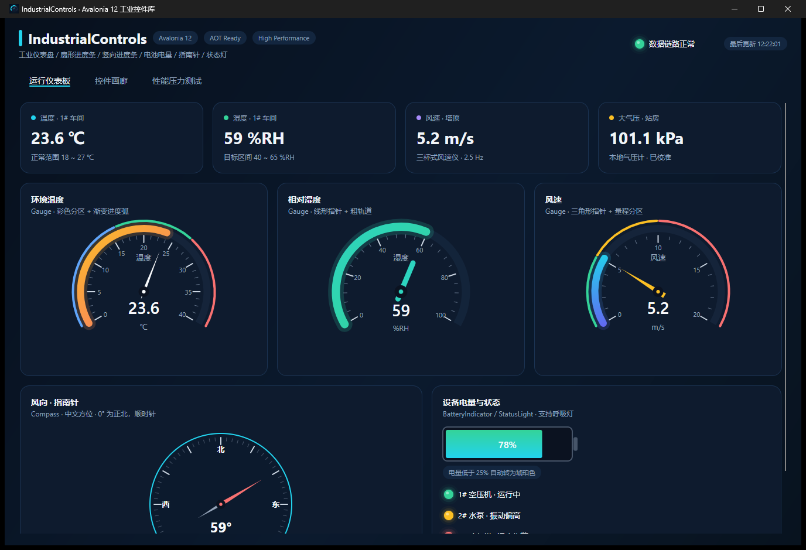
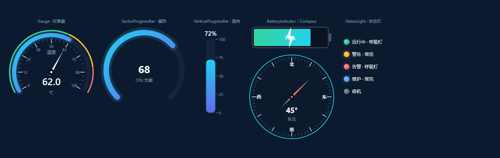
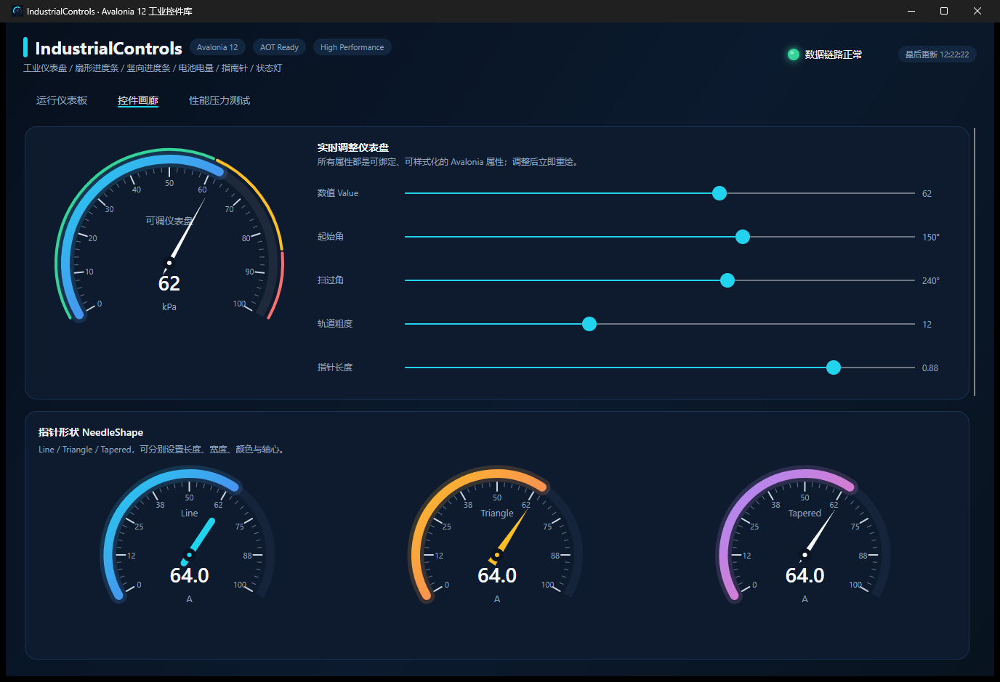
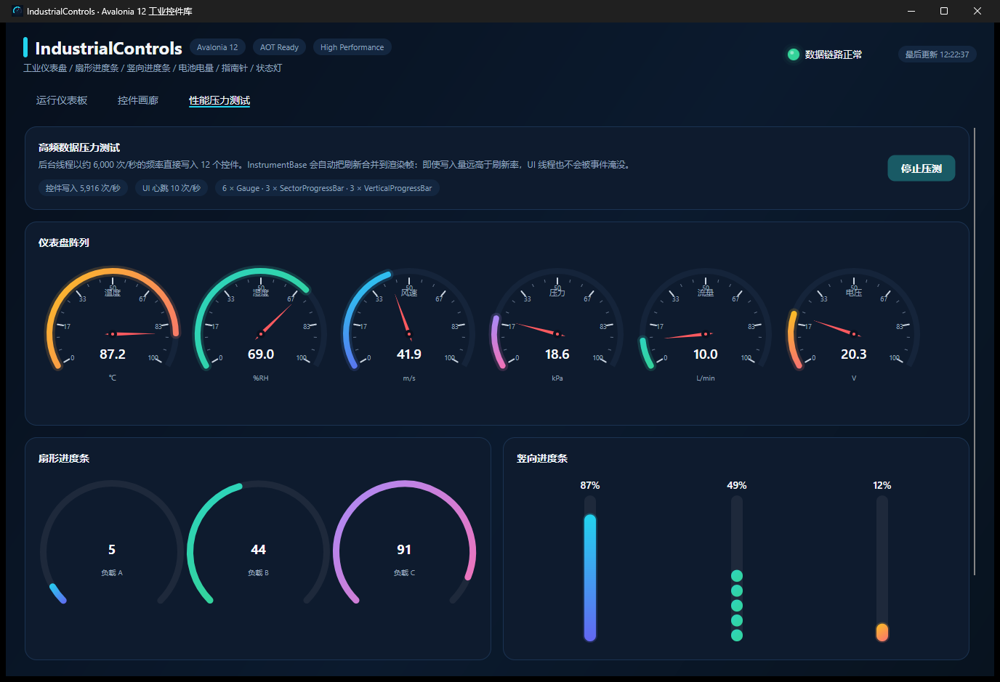

# IndustrialControls · Avalonia 12 工业控件库

[简体中文](README.md) | [English](README.en.md)

一套面向 **Avalonia 12 / .NET 8+** 的工业控件：仪表盘、扇形进度条、竖向进度条、电池电量、指南针、设备状态灯。
深色工业风外观、属性高度可定制、AOT 友好，并针对**高频数据刷新**做了渲染合并与缓存优化。

[](https://www.nuget.org/packages/IndustrialControls.Avalonia)
[](https://avaloniaui.net/)
[](https://dotnet.microsoft.com/)
[](LICENSE)



---

## 1. 特性

| 能力 | 说明 |
|---|---|
| 工业仪表盘 `Gauge` | 自定义扇形刻度范围、刻度密度、彩色分区、指针形状/长度/宽度/颜色、标题/单位/数值文字的位置·字号·颜色·字体 |
| 扇形进度条 `SectorProgressBar` | 270° / 360° 任意弧度，支持渐变画刷、圆角端点、柔光、中心数值与说明文字 |
| 竖向进度条 `VerticalProgressBar` | 连续/分段填充、上下方向、圆角、右侧刻度、顶部数值，适合液位、料位、湿度 |
| 电池电量 `BatteryIndicator` | 电量填充、低电量/危险自动配色、充电闪电标识、百分比文字 |
| 指南针 `Compass` | 航向角、中英文方位、角度与方位名称、主副刻度，可直接表示风向 |
| 设备状态灯 `StatusLight` | 运行/警告/告警/维护/停机，支持呼吸灯与说明文字 |
| 高频数据刷新 | `Value` 可从任意线程赋值，控件自动封送到 UI 线程并按帧合并；静态部分缓存 |
| AOT / 裁剪 | `IsAotCompatible`，不使用反射、动态类型或运行时序列化；XAML 编译绑定 |
| 跨平台 | Windows / Linux / macOS（Avalonia 12 支持的全部桌面平台） |

> 本项目为独立实现。仅在“工业仪表盘的交互与视觉概念”上参考了社区中的同类项目，
> 未复制任何第三方源码、图片或资源，所有绘制代码、API 设计与配色均为原创。

---

## 2. 环境要求

- Avalonia **12.1.6** 及以上
- .NET **8.0** 及以上（库的目标框架为 `net8.0`，可被 net8 / net9 / net10 的宿主引用）
- 桌面平台：Windows / Linux / macOS

---

## 3. 安装与引用

### 3.1 NuGet

```bash
dotnet add package IndustrialControls.Avalonia --version 1.0.0
```

### 3.2 项目引用

```xml
<ItemGroup>
  <ProjectReference Include="..\IndustrialControls\src\IndustrialControls\IndustrialControls.csproj" />
</ItemGroup>
```

### 3.3 引入命名空间

```xml
xmlns:ic="https://github.com/daipeng0809/IndustrialControls"
```

---

## 4. 快速开始

```xml
<UserControl xmlns="https://github.com/avaloniaui"
             xmlns:x="http://schemas.microsoft.com/winfx/2006/xaml"
             xmlns:ic="https://github.com/daipeng0809/IndustrialControls">

  <ic:Gauge Width="300" Height="300"
            Minimum="0" Maximum="100" Value="42"
            Title="温度" Unit="℃" ValueFormat="F1"
            ProgressBrush="#22D3EE"
            TrackBrush="#15243A">

    <!-- 彩色分区：正常 / 警告 / 危险 -->
    <ic:Gauge.Ranges>
      <ic:GaugeRange From="0"  To="60" Brush="#34D399" />
      <ic:GaugeRange From="60" To="85" Brush="#FBBF24" />
      <ic:GaugeRange From="85" To="100" Brush="#F87171" />
    </ic:Gauge.Ranges>
  </ic:Gauge>
</UserControl>
```

```csharp
// 采集线程（非 UI 线程）直接赋值即可，控件会自动封送并按帧合并刷新
gauge.Value = ReadSensorValue();
```

运行示例：

```bash
dotnet run --project samples/IndustrialControls.Demo
```

---

## 5. 数据刷新与性能设计

### 5.1 任意线程写 `Value`

所有控件的 `Value` 都是 **DirectProperty**，setter 内部做了两件事：

1. **线程封送**：如果当前不在控件所属的 Dispatcher 上，只记录“最新待处理值”，不再直接改 UI 状态；
2. **帧级合并**：同一时刻最多只有一个待处理的封送任务，下一帧只把最新值写入属性并重绘一次。

因此下面的写法是安全的，即使每秒写入上万次也不会淹没 UI 线程：

```csharp
_ = Task.Run(async () =>
{
    while (true)
    {
        gauge.Value = ReadSensorValue();   // 采集线程直接写
        await Task.Delay(10);
    }
});
```

> 注意：`Value` 使用 DirectProperty 是为了在 setter 内完成封送与合并。它**支持绑定**（OneWay / TwoWay），
> 但**不支持 Style Setter**。除 `Value` 外，其余外观属性都是普通的 StyledProperty，可样式化、可动画。

### 5.2 为什么大数据量下不卡 UI

| 优化 | 位置 | 效果 |
|---|---|---|
| 刷新请求合并 | `InstrumentBase.RequestRender` / `Value` setter | 后台高频写入只产生极少量 UI 线程任务 |
| 静态缓存 | 各控件的 `RebuildStatic` | 刻度、刻度数字、色带、标题等只在尺寸/外观变化时重建 |
| 几何复用 | `MutableArc` / 指针缓存几何 | 进度弧与指针每帧只更新参数，不重新分配几何对象 |
| 文本缓存 | `FormattedText` 字段复用 | 数值文字只在格式化结果变化时才重新排版 |
| 纯绘制控件 | 直接重写 `Render(DrawingContext)` | 没有子控件、没有模板、数值变化不触发测量/布局 |
| 不可变默认画刷 | `IndustrialPalette` | 默认画刷跨控件共享，避免每帧分配 |

示例程序的压力测试页实测：**约 6,000 次/秒** 控件写入，**UI 心跳稳定 10/10 次/秒**，无卡顿、无跨线程异常。

### 5.3 线程约定

- `Value`：**任意线程**可写。
- `Minimum` / `Maximum` / `Ranges` / 字体、颜色、角度等外观属性：请在 **UI 线程**修改（属于一次性配置）。
- `StatusLight` 的呼吸动画使用 `DispatcherTimer`，只在 `IsPulsing = true` 且控件在可视树中时运行。

---

## 6. 角度约定

所有角度单位为**度**，`0°` 指向 **3 点钟方向**，**顺时针为正**：

- `Gauge` 默认 `StartAngle = 150`、`SweepAngle = 240`：从左下开始，顺时针扫到右下，开口向下。
- `SectorProgressBar` 默认 `StartAngle = 135`、`SweepAngle = 270`。
- `Compass` 的 `Value` 表示航向角：`0` 为正北，顺时针递增（东 = 90、南 = 180、西 = 270）。

---

## 7. 控件文档



### 7.1 `Gauge` 仪表盘

#### 数值与文字

| 属性 | 默认值 | 说明 |
|---|---|---|
| `Value` / `Minimum` / `Maximum` | `0 / 0 / 100` | 当前值与量程 |
| `ValueFormat` | `"F1"` | 数值格式（`"F0"`、`"0.0"` 等） |
| `ShowValueText` | `true` | 是否显示数值 |
| `ValueFontSize` / `ValueBrush` / `ValueFontFamily` / `ValueFontWeight` | `28` / 浅白 / 系统 / `SemiBold` | 数值字体样式 |
| `ValueOffset` | `(0, 26)` | 数值相对表盘中心的像素偏移 |
| `Title` / `TitleFontSize` / `TitleBrush` / `TitleFontFamily` / `TitleOffset` | 空 / `13` / 灰 / 系统 / `(0, -58)` | 标题文字 |
| `Unit` / `UnitFontSize` / `UnitBrush` / `UnitFontFamily` / `UnitOffset` | 空 / `13` / 灰 / 系统 / `(0, 60)` | 单位文字 |

`TitleOffset`、`UnitOffset`、`ValueOffset` 都是 `Point`，可写成 `"0,60"`；文字始终以该点为中心绘制。

#### 刻度盘与刻度

| 属性 | 默认值 | 说明 |
|---|---|---|
| `StartAngle` / `SweepAngle` | `150 / 240` | 扇形刻度范围 |
| `TrackThickness` / `TrackBrush` | `12` / `#1E293B` | 轨道粗度与颜色 |
| `ShowProgress` / `ProgressBrush` / `ProgressGlow` | `true` / `#22D3EE` / `true` | 进度弧（可设渐变）与柔光 |
| `ShowTickMarks` | `true` | 是否显示刻度线 |
| `MajorTickCount` | `11` | 主刻度数量（含两端） |
| `MinorTicksPerMajor` | `4` | 两个主刻度之间的副刻度数 |
| `MajorTickLength` / `MinorTickLength` | `12 / 6` | 刻度长度 |
| `MajorTickWidth` / `MinorTickWidth` | `2 / 1` | 刻度线宽 |
| `MajorTickBrush` / `MinorTickBrush` | `#CBD5E1` / `#64748B` | 刻度颜色 |
| `ShowScaleLabels` / `ScaleLabelFormat` | `true` / `"F0"` | 是否显示刻度数字及格式 |
| `ScaleLabelFontSize` / `ScaleLabelBrush` / `ScaleLabelFontFamily` / `ScaleLabelOffset` | `11` / `#94A3B8` / 系统 / `8` | 刻度数字样式与径向间距 |

#### 指针

| 属性 | 默认值 | 说明 |
|---|---|---|
| `ShowNeedle` | `true` | 是否显示指针 |
| `NeedleShape` | `Tapered` | `Line` / `Triangle` / `Tapered` |
| `NeedleLength` | `0.88` | 相对于刻度内圈的 0~1 比例 |
| `NeedleWidth` | `6` | 指针宽度 |
| `NeedleBackLength` | `0.16` | 尾部长度比例（Triangle / Tapered） |
| `NeedleBrush` | `#FF5A5F` | 指针颜色 |
| `NeedleHubRadius` / `NeedleHubBrush` | `9` / `#0B1220` | 轴心半径与颜色 |

#### 彩色分区

| 属性 | 默认值 | 说明 |
|---|---|---|
| `Ranges` | 空 | `GaugeRange` 集合，按值域着色 |
| `RangeThickness` / `RangeGap` | `4 / 2` | 外圈色带粗度与间隔角度 |

`GaugeRange`：`From`、`To`、`Brush`、`Thickness`（`NaN` 表示使用 `Gauge.RangeThickness`）。
修改集合或任意分区的属性后，仪表盘会自动刷新。

#### 自定义示例

```xml
<!-- 风速：三角形指针、量程分区、白色刻度文字 -->
<ic:Gauge Width="300" Height="300"
          Minimum="0" Maximum="20" Value="8.6"
          StartAngle="200" SweepAngle="220"
          TrackThickness="10"
          Title="风速" Unit="m/s" ValueFormat="F1"
          TitleFontSize="12" UnitFontSize="12"
          ValueFontSize="30" ValueOffset="0,34"
          TitleOffset="0,-72" UnitOffset="0,68"
          ScaleLabelFontSize="10" ScaleLabelOffset="6"
          MajorTickCount="5" MinorTicksPerMajor="4"
          NeedleShape="Triangle" NeedleWidth="10" NeedleLength="0.9"
          NeedleBrush="#FBBF24"
          ProgressBrush="#22D3EE">
  <ic:Gauge.Ranges>
    <ic:GaugeRange From="0" To="5" Brush="#34D399" />
    <ic:GaugeRange From="5" To="10" Brush="#FBBF24" />
    <ic:GaugeRange From="10" To="20" Brush="#F87171" />
  </ic:Gauge.Ranges>
</ic:Gauge>
```

### 7.2 `SectorProgressBar` 扇形进度条

| 属性 | 默认值 | 说明 |
|---|---|---|
| `Value` / `Minimum` / `Maximum` | `0 / 0 / 100` | 数值与量程 |
| `StartAngle` / `SweepAngle` | `135 / 270` | 扇形范围；`SweepAngle = 360` 为整圆 |
| `Thickness` | `14` | 弧线粗度 |
| `TrackBrush` / `ProgressBrush` | `#1E293B` / `#22D3EE` | 轨道/进度颜色（支持渐变） |
| `ProgressGlow` | `true` | 进度弧柔光 |
| `RoundCaps` | `true` | 端点是否圆角 |
| `ShowValueText` / `ValueFormat` | `true` / `"F0"` | 中心数值 |
| `ValueFontSize` / `ValueBrush` / `ValueFontFamily` / `ValueFontWeight` / `ValueOffset` | `30` / 白 / 系统 / `Bold` / `(0,-4)` | 数值样式 |
| `Label` / `LabelFontSize` / `LabelBrush` / `LabelFontFamily` / `LabelOffset` | 空 / `12` / 灰 / 系统 / `(0,28)` | 说明文字 |

```xml
<ic:SectorProgressBar Height="240" Value="68" Label="CPU 负载"
                      StartAngle="135" SweepAngle="270" Thickness="16"
                      TrackBrush="#15243A">
  <ic:SectorProgressBar.ProgressBrush>
    <LinearGradientBrush StartPoint="0%,0%" EndPoint="100%,100%">
      <GradientStop Color="#22D3EE" Offset="0" />
      <GradientStop Color="#6366F1" Offset="1" />
    </LinearGradientBrush>
  </ic:SectorProgressBar.ProgressBrush>
</ic:SectorProgressBar>

<!-- 整圆环形进度条 -->
<ic:SectorProgressBar Height="200" Value="42" StartAngle="-90" SweepAngle="360"
                      Thickness="16" ProgressBrush="#A78BFA" />
```

### 7.3 `VerticalProgressBar` 竖向进度条

| 属性 | 默认值 | 说明 |
|---|---|---|
| `Direction` | `BottomToTop` | 填充方向，或 `TopToBottom` |
| `BarWidth` / `CornerRadius` | `22 / 8` | 条体宽度与圆角 |
| `TrackBrush` / `ProgressBrush` / `ProgressGlow` | `#1E293B` / `#22D3EE` / `true` | 轨道与填充 |
| `SegmentCount` / `SegmentGap` | `0 / 4` | 分段数量（0 = 连续）与间距 |
| `ShowValueText` / `ValueFormat` / `Unit` | `true` / `"F0"` / 空 | 顶部数值 |
| `ValueFontSize` / `ValueBrush` / `ValueFontFamily` / `ValueFontWeight` | `18` / 白 / 系统 / `SemiBold` | 数值样式 |
| `ShowScale` / `ScaleCount` | `false / 5` | 右侧刻度 |
| `TickLength` / `TickWidth` / `TickBrush` | `6 / 1.5` / `#64748B` | 刻度线 |
| `ScaleLabelFormat` / `ScaleLabelFontSize` / `ScaleLabelBrush` / `ScaleLabelFontFamily` | `"F0"` / `11` / 灰 / 系统 | 刻度数字 |

```xml
<!-- 液位：连续 + 刻度 -->
<ic:VerticalProgressBar Width="90" Height="260" Value="72" Unit="%"
                        ShowScale="True" ScaleCount="5"
                        BarWidth="28" CornerRadius="10"
                        ProgressBrush="#22D3EE" />

<!-- 分段电量/料位 -->
<ic:VerticalProgressBar Width="80" Height="260" Value="55" Unit="%"
                        SegmentCount="12" SegmentGap="4"
                        BarWidth="26" ProgressBrush="#34D399" />
```

### 7.4 `BatteryIndicator` 电池电量

| 属性 | 默认值 | 说明 |
|---|---|---|
| `Value` | `0` | 电量（配合 `Minimum`/`Maximum`，默认 0~100） |
| `BodyBrush` / `BorderBrush` / `BorderThickness` / `CornerRadius` | `#0B1220` / `#475569` / `2` / `8` | 外壳 |
| `TerminalBrush` / `TerminalWidth` / `TerminalHeightRatio` | `#475569` / `7` / `0.4` | 正极帽 |
| `FillPadding` | `3` | 填充内边距 |
| `FillBrush` / `LowBrush` / `CriticalBrush` | 绿 / 琥珀 / 红 | 三级配色 |
| `UseLevelColors` / `LowThreshold` / `CriticalThreshold` | `true` / `0.3` / `0.15` | 是否按电量自动换色 |
| `IsCharging` / `ShowChargingBolt` / `ChargingBoltBrush` | `false` / `true` / 白 | 充电状态与闪电 |
| `ShowValueText` / `ValueFormat` / `Unit` | `true` / `"F0"` / `"%"` | 电量文字 |
| `ValueFontSize` / `ValueBrush` / `ValueFontFamily` / `ValueFontWeight` | `16` / 白 / 系统 / `SemiBold` | 文字样式 |

```xml
<ic:BatteryIndicator Width="220" Height="56" Value="82" IsCharging="True" />
<ic:BatteryIndicator Width="220" Height="56" Value="8" />   <!-- 自动变红 -->
```

### 7.5 `Compass` 指南针 / 风向

| 属性 | 默认值 | 说明 |
|---|---|---|
| `Value` | `0` | 航向角 0~360（0 = 正北，顺时针） |
| `ShowCardinalLabels` / `UseChineseCardinalLabels` | `true / false` | 显示 N/E/S/W 或 北/东/南/西 |
| `CardinalLabelFontSize` / `CardinalLabelBrush` / `CardinalLabelFontFamily` | `13` / 白 / 系统 | 方位文字 |
| `TickCount` / `MajorTickEvery` | `72 / 6` | 圆周刻度数量与主刻度间隔 |
| `MajorTickLength` / `MinorTickLength` / `MajorTickWidth` / `MinorTickWidth` | `12 / 6 / 2 / 1` | 刻度尺寸 |
| `MajorTickBrush` / `MinorTickBrush` | `#CBD5E1` / `#64748B` | 刻度颜色 |
| `DialBrush` / `BezelBrush` / `BezelThickness` | `#1E293B` / `#475569` / `2` | 表盘与外圈 |
| `ShowNeedle` / `NeedleBrush` / `SouthNeedleBrush` | `true` / 红 / 灰 | 指针 |
| `NeedleLength` / `NeedleWidth` / `NeedleHubRadius` / `NeedleHubBrush` | `0.62 / 6 / 8 / #0B1220` | 指针尺寸与轴心 |
| `ShowHeadingText` / `HeadingFormat` / `ShowDegreeSymbol` | `true / "F0" / true` | 角度文字 |
| `HeadingFontSize` / `HeadingBrush` / `HeadingFontFamily` / `HeadingFontWeight` / `HeadingOffset` | `22` / 白 / 系统 / `Bold` / `(0,42)` | 角度文字样式 |
| `ShowDirectionText` / `DirectionFontSize` / `DirectionBrush` / `DirectionFontFamily` / `DirectionOffset` | `true / 12 / 灰 / 系统 / (0,66)` | 方位名称（如“东北”） |

```xml
<!-- 风向：中文方位，45° 表示东北风 -->
<ic:Compass Width="240" Height="240" Value="45"
            UseChineseCardinalLabels="True"
            DialBrush="#0C1A2D" BezelBrush="#22D3EE" />
```

### 7.6 `StatusLight` 设备状态灯

| 属性 | 默认值 | 说明 |
|---|---|---|
| `Status` | `Off` | `Off` / `Normal` / `Warning` / `Alarm` / `Maintenance` |
| `IsPulsing` | `false` | 呼吸灯（仅控件在可视树中时运行） |
| `Diameter` / `ShowHalo` | `16 / true` | 灯珠直径与光晕 |
| `Label` / `LabelFontSize` / `LabelBrush` / `LabelFontFamily` / `LabelGap` | 空 / `13` / 白 / 系统 / `8` | 右侧说明文字 |

```xml
<ic:StatusLight Status="Normal" Label="1# 空压机 · 运行中" IsPulsing="True" />
<ic:StatusLight Status="Alarm" Label="3# 冷却塔 · 温度告警" IsPulsing="True" />
```

---

## 8. 示例程序

示例应用 `samples/IndustrialControls.Demo` 包含三个页面：

1. **运行仪表板**：温度 / 湿度 / 风速 / 风向 / 电池 / 设备状态，模拟 400 ms 随机游走数据。
2. **控件画廊**：所有控件与可调属性（滑块实时调整起始角、扫过角、轨道粗度、指针长度），三种指针形状对比。
3. **性能压力测试**：后台线程以约 6,000 次/秒写入 12 个控件，并显示 UI 心跳，验证刷新合并效果。





```bash
dotnet run --project samples/IndustrialControls.Demo
```

---

## 9. AOT 发布

库已开启 `IsAotCompatible` / `IsTrimmable`，不依赖反射或运行时序列化；示例使用 Avalonia 12 编译绑定
（`AvaloniaUseCompiledBindingsByDefault`），可直接发布为 AOT 原生程序：

```bash
dotnet publish samples/IndustrialControls.Demo -c Release -r win-x64 -p:PublishAot=true
dotnet publish samples/IndustrialControls.Demo -c Release -r linux-x64 -p:PublishAot=true
dotnet publish samples/IndustrialControls.Demo -c Release -r osx-arm64 -p:PublishAot=true
```

AOT 需要对应平台的 C++ 工具链（Windows 上需要 Visual Studio 的 “使用 C++ 的桌面开发” 工作负载）。

---

## 10. NuGet 打包与发布

```bash
# 生成 nupkg + snupkg
dotnet pack src/IndustrialControls/IndustrialControls.csproj -c Release -o artifacts

# 推送到 nuget.org
dotnet nuget push artifacts/IndustrialControls.Avalonia.1.0.0.nupkg \
  --api-key <YOUR_API_KEY> \
  --source https://api.nuget.org/v3/index.json
```

包内已包含：`README.md` / `README.en.md`、`icon.png`、XML 文档、符号包。发布前请按需修改
`src/IndustrialControls/IndustrialControls.csproj` 中的 `Authors`、`RepositoryUrl` 与 `Version`。

---

## 11. 目录结构

```
IndustrialControls/
├── IndustrialControls.sln
├── README.md                            # 中文
├── README.en.md                         # English
├── LICENSE
├── assets/                              # 图标与截图
├── src/IndustrialControls/
│   ├── IndustrialControls.csproj
│   ├── AssemblyInfo.cs                  # XAML 命名空间映射
│   ├── Controls/
│   │   ├── InstrumentBase.cs            # 数值、渲染合并、静态缓存基类
│   │   ├── Gauge.cs
│   │   ├── SectorProgressBar.cs
│   │   ├── VerticalProgressBar.cs
│   │   ├── BatteryIndicator.cs
│   │   ├── Compass.cs
│   │   └── StatusLight.cs
│   ├── Models/                          # GaugeRange / NeedleShape / IndicatorStatus / BarDirection
│   └── Primitives/                      # 绘图与配色辅助（内部）
└── samples/IndustrialControls.Demo/     # 示例应用
```

---

## 12. 常见问题（FAQ）

**Q1：后台线程直接给 `Value` 赋值会抛“调用线程无法访问此对象”吗？**
不会。`Value` 的 setter 会把非 UI 线程的写入封送到控件所属的 Dispatcher，并合并到下一帧。
但 `Minimum`、`Maximum`、字体、颜色、`Ranges` 等外观属性请在 UI 线程配置。

**Q2：为什么 `Value` 不能写在 `<Style>` 里？**
为了在 setter 内实现线程封送与帧级合并，`Value` 使用了 DirectProperty。DirectProperty 支持绑定但不支持样式 Setter。
如果需要“样式化数值”，可用绑定或代码赋值；外观属性不受影响。

**Q3：数值变化会不会触发重新测量/布局？**
不会。控件只调用 `InvalidateVisual()`，不实现 `AffectsMeasure`；数值变化只重绘指针/进度弧。

**Q4：刻度文字太多、重叠怎么办？**
减小 `MajorTickCount`、增大控件尺寸，或设置 `ShowScaleLabels="False"`。竖向进度条可减小 `ScaleCount`。

**Q5：如何让仪表盘更“花哨”？**
- `ProgressBrush` 使用 `LinearGradientBrush`；
- 设置 `Gauge.Ranges` 做彩色分区；
- 打开 `ProgressGlow`（默认已开启）；
- 调整 `TrackThickness`、`StartAngle`、`SweepAngle` 得到不同的扇形；
- 通过 `TitleOffset`、`UnitOffset`、`ValueOffset` 精确定位文字。

**Q6：支持浅色主题吗？**
支持。所有颜色都是画刷属性，可在浅色背景下覆盖；示例默认使用深色工业风。字体默认跟随系统。

**Q7：`Compass` 的 `Value` 超出 0~360 会怎样？**
显示时会自动按 360 取模（例如 `-30` 显示为 `330°`），不会抛异常。

**Q8：状态灯的呼吸动画会一直占用 CPU 吗？**
只有 `IsPulsing = true` 且控件在可视树中时才启动 33 ms 的 `DispatcherTimer`；关闭或移出可视树后立即停止。

**Q9：控件能否在 `ItemsControl` / `DataTemplate` 中大量使用？**
可以。控件没有模板和子视觉树，`Value` 更新只重绘自身；但仍建议避免在 `DataTemplate` 中放置数百个仪表盘。


---

## 13. 许可

[MIT](LICENSE) © 2026 daipeng0809

欢迎提交 Issue / PR。若用于商业项目，请保留许可证声明。
